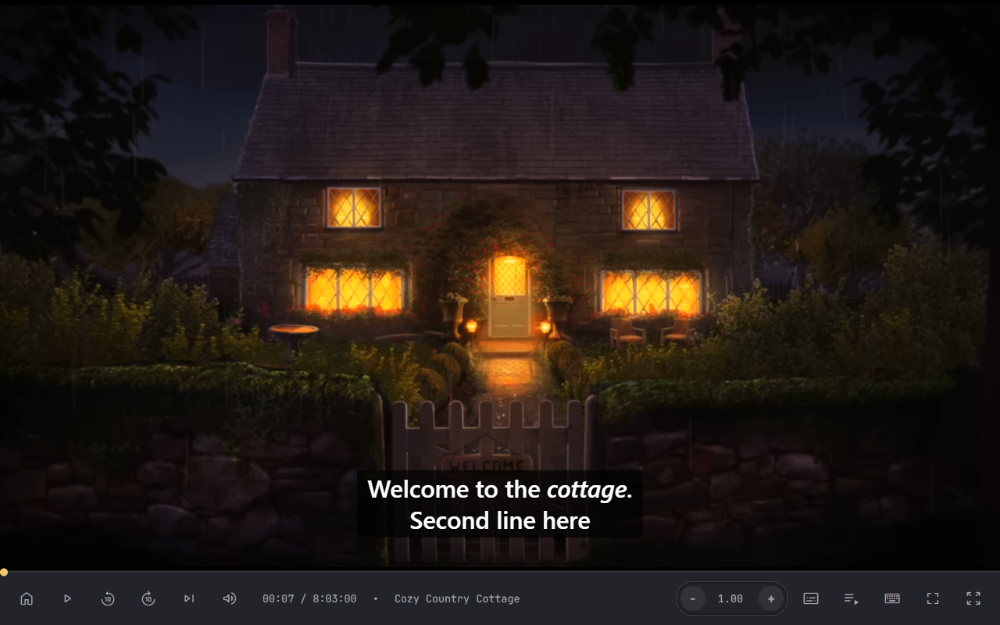
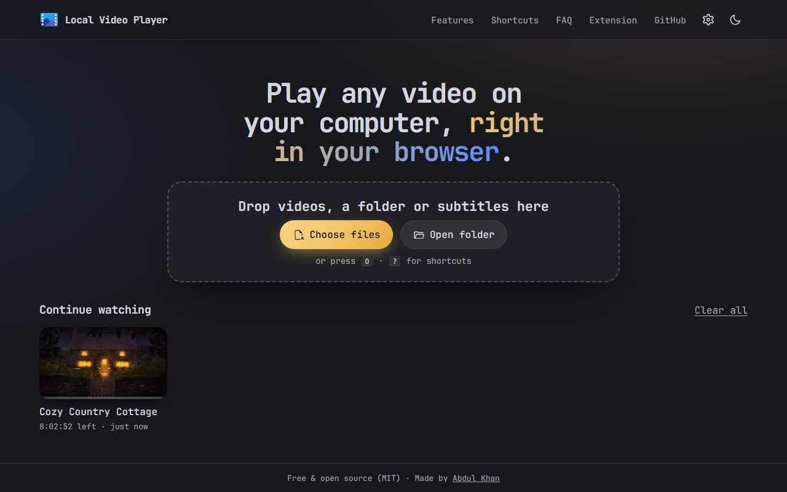

# Local Video Player: A Free, Private Video Player for Your Browser

[](https://abduldevhub.github.io/Local-Video-Player/)
[](#install-the-chrome-extension)
[](https://github.com/AbdulDevHub/Local-Video-Player/releases/latest)
[](LICENSE)

Play MP4, MKV, WebM, MP3 and other files from your computer, straight in the browser. Nothing is uploaded. It remembers where you stopped, plays whole folders as a playlist, shows SRT/VTT subtitles, goes up to 16× speed and boosts quiet audio to 500%.

Use it as a **website** (installable, works offline) or as a **Chrome extension**. Both run the same code.

**[▶ Open Local Video Player](https://abduldevhub.github.io/Local-Video-Player/)**



## Features

- **Continue watching:** your position and speed are saved for every file. The start screen shows partly watched videos with thumbnails, and in Chrome and Edge one click reopens the file, paused at the spot where you stopped.
- **Playlists and folders:** drop several files or a whole folder. Files play in natural order (episode 2 before episode 10) and the next one starts automatically.
- **Subtitles:** SRT and VTT, matched to the video by file name. You can shift the timing in 0.1 s steps and resize the text.
- **Speed control:** 0.1× to 16× in 0.1× steps, plus one-key presets for 1.5×, 2×, 2.5×, 3× and 4×.
- **500% volume boost** for quiet recordings.
- **Power tools:** A-B loop, frame-by-frame stepping, full-resolution screenshots and jumping to 0–90% with the number keys.
- **Smart stretch to fill:** the stretch adapts to your screen and window size, leaves vertical videos alone and skips videos that would be distorted too much. Crop-to-fill and arrow-key fine-tuning are there too.
- **Settings:** choose which buttons appear on the player (hide subtitles, playlist, zoom and more), plus autoplay, resume, skip amount (5/10/30 s), stretch limits and theme.
- **On-screen feedback** for every shortcut, and a cheat sheet that opens with <kbd>?</kbd>.
- **Light, dark or system theme.**
- **Works offline and installs as an app.** Once installed, it shows up under *Open with* for video files on your computer.
- **Integrates with your system's media controls** (play/pause, skip, next/previous track).
- **Album art** from MP3 files is shown while the audio plays.



## Use It Online

Open **<https://abduldevhub.github.io/Local-Video-Player/>**, then drop a video onto the page or click **Choose files**. To install it as an app, use **Install app** on the start screen (Chrome/Edge), or *Add to Dock* / *Add to Home Screen* in Safari.

It works in Chrome, Edge, Firefox and Safari. Chrome and Edge get the extras: one-click resume from Continue Watching, folder picking and *Open with* for the installed app.

## Install the Chrome Extension

1. Download `local-video-player-extension.zip` from the [latest release](https://github.com/AbdulDevHub/Local-Video-Player/releases/latest) and unzip it, or clone this repository.
2. Go to `chrome://extensions/` and switch on **Developer mode** (top right).
3. Click **Load unpacked** and select the unzipped folder.
4. Click the extension's icon or press <kbd>Alt</kbd>+<kbd>V</kbd> to open the player. You can change the shortcut at `chrome://extensions/shortcuts`.

## Keyboard Shortcuts

Press <kbd>?</kbd> in the player to see this list.

| Key | Action |
| :-: | --- |
| <kbd>Space</kbd> / <kbd>K</kbd> | Play / pause |
| <kbd>←</kbd> / <kbd>→</kbd> | Skip back / forward (10 s by default, change it in Settings) |
| <kbd>0</kbd> – <kbd>9</kbd> | Jump to 0% – 90% |
| <kbd>,</kbd> / <kbd>.</kbd> | Previous / next frame |
| <kbd>N</kbd> / <kbd>B</kbd> | Next / previous in playlist |
| <kbd>L</kbd> | Show the playlist |
| <kbd>S</kbd> / <kbd>D</kbd> | Speed up / slow down by 0.1× |
| <kbd>A</kbd> | Reset speed to 1× |
| <kbd>Q</kbd> <kbd>W</kbd> <kbd>E</kbd> <kbd>R</kbd> <kbd>T</kbd> | 1.5× / 2× / 2.5× / 3× / 4× (press again for 1×) |
| Click the speed | Cycle through the presets |
| <kbd>↑</kbd> / <kbd>↓</kbd> | Volume up (to 500%) / down |
| <kbd>M</kbd> | Mute |
| <kbd>Y</kbd> | Subtitles on / off |
| <kbd>F</kbd> | Fullscreen |
| <kbd>G</kbd> | Fullscreen or zoom |
| <kbd>C</kbd> | Crop to fill |
| <kbd>U</kbd> | Stretch to fill |
| <kbd>Ctrl</kbd> + <kbd>↑</kbd><kbd>→</kbd><kbd>↓</kbd><kbd>←</kbd> | Fine-tune the stretch |
| <kbd>P</kbd> | Picture-in-picture |
| <kbd>H</kbd> | Hide the controls |
| <kbd>V</kbd> | Thin progress bar while the controls are hidden |
| <kbd>[</kbd> / <kbd>]</kbd> / <kbd>\\</kbd> | Set loop start / set loop end / clear the loop |
| <kbd>I</kbd> | Save a screenshot |
| <kbd>Shift</kbd> + <kbd>Z</kbd> | Giant seeker (move the mouse to scrub) |
| <kbd>Z</kbd> | Turn thumbnail previews on the progress bar on or off (default is set in Settings) |
| <kbd>O</kbd> | Open files |
| Click the time | Switch between elapsed and remaining time |

## Privacy

Everything happens on your device. Files are read by your browser and never uploaded. Saved positions, speeds and thumbnails stay in your browser's storage and are forgotten after 30 days without use, or when you clear your browsing data. There are no accounts, analytics or ads.

## Development

There is no build step: it's plain HTML, CSS and JavaScript modules.

```sh
git clone https://github.com/AbdulDevHub/Local-Video-Player.git
cd Local-Video-Player
npx serve .            # or any static file server, then open the printed URL
```

To work on the extension, load the folder with **Load unpacked** (see above) and reload it after changes.

| Path | What it does |
| --- | --- |
| `index.html` | The start screen and player markup, with SEO metadata |
| `scripts/player.js` | Core player: playback, speed, volume, fullscreen, stretching, seeking, saved progress |
| `scripts/files.js` | Drag and drop, file and folder pickers, *Open with* for the installed app |
| `scripts/playlist.js` | Play queue and auto-advance |
| `scripts/library.js` | Continue Watching shelf (IndexedDB) |
| `scripts/subtitles.js` | SRT/VTT parsing and rendering |
| `scripts/settings.js` | Settings panel: visible buttons, autoplay, resume, skip amount, stretch limits |
| `scripts/tools.js` | New shortcuts, A-B loop, frame steps, screenshots, on-screen feedback |
| `scripts/pwa.js`, `sw.js`, `app.webmanifest` | Theme switching, offline support, install |
| `manifest.json`, `scripts/background.js` | Chrome extension |

Pushing to `main` deploys the website through GitHub Actions. Pushing a `v*` tag publishes a release with the extension zip.

## Contributing

This is a personal project, but suggestions and pull requests are welcome. Please [open an issue](https://github.com/AbdulDevHub/Local-Video-Player/issues) first.

## License

MIT. See [LICENSE](LICENSE).
